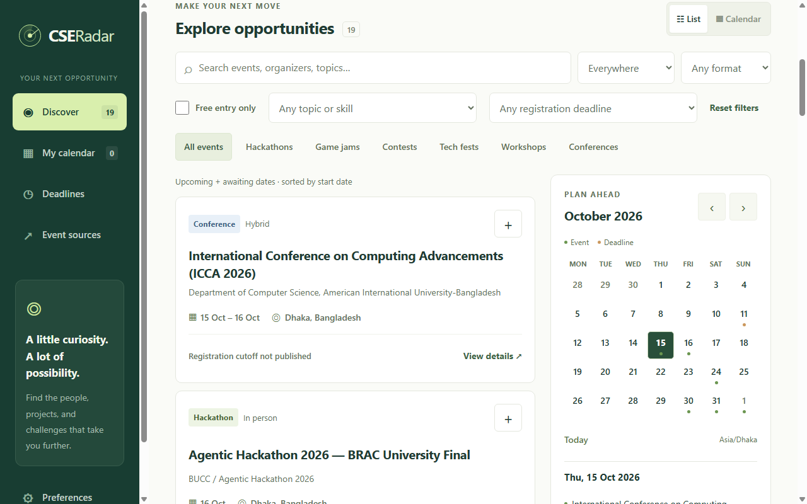
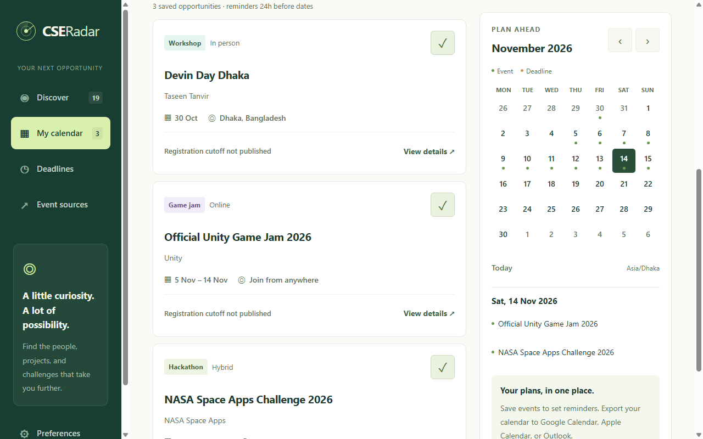
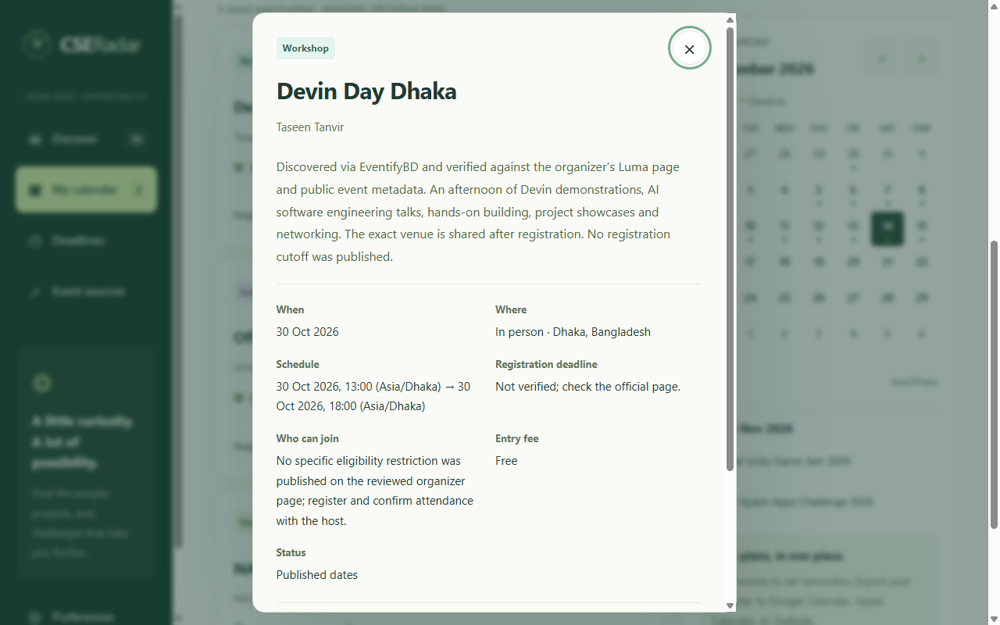

<div align="center">


<h1>CSE Radar</h1>

<p><strong>Your next opportunity, on your radar.</strong></p>

<p>Find hackathons, game jams, programming contests, and university tech events.<br>Explore Bangladesh and beyond. Save what matters. Plan your next step.</p>

<p>
  <a href="https://github.com/SayemTanvir/CSE-Radar/releases/tag/v1.0.0"></a>
  <a href="LICENSE"></a>
  <a href="https://github.com/SayemTanvir/CSE-Radar/actions/workflows/catalog.yml"></a>
</p>

<p>
  <a href="https://github.com/SayemTanvir/CSE-Radar/releases/download/v1.0.0/cse-radar-1.0.0-chromium.zip"><strong>Download for Chrome · Brave · Edge</strong></a>
  &nbsp; / &nbsp;
  <a href="#installation"><strong>Installation guide</strong></a>
</p>

<p><sub>Free and open source · No account required · No ads or analytics</sub></p>



<p><a href="#what-you-can-do">Features</a> · <a href="#a-closer-look">Screenshots</a> · <a href="#browser-compatibility">Browsers</a> · <a href="#questions-you-might-have">FAQ</a> · <a href="docs/PRIVACY.md">Privacy</a> · <a href="https://github.com/SayemTanvir/CSE-Radar/issues">Get help</a></p>

</div>

---

### Less searching. More opportunities to build.

A great event can lead to a new skill, a teammate, or your next project. **CSE Radar** helps students and developers bring those opportunities together: discover reviewed events, check organizer details, and keep a personal calendar right in the browser.

Start with the bundled catalog, save an event that interests you, and make it part of your plan.

## What you can do

| Feature | How it helps |
| --- | --- |
| 🔎 Find your next event | Search a reviewed catalog by topic, region, format, category, free entry, and known registration deadlines. |
| 🗓️ Make a plan | Save opportunities to your calendar and keep official event, source, and registration links close by. |
| 🔔 Remember what matters | Get browser reminders for saved events and verified registration cutoffs. |
| 📌 Save an event you found | Turn published webpage metadata into a draft you can review and complete before saving. |
| ✏️ Keep it personal | Add, edit, or cancel your own events with timezone-aware dates, topics, and links. |
| 📂 Bring your calendar along | Review local `.ics` imports or export event dates and known deadlines to another calendar app. |
| ↻ Refresh when you choose | Opt in to public catalog updates and keep the last valid catalog available offline. |

No account, subscription, or API key is required. Saved events and preferences are stored locally in the browser. There are no ads or analytics.

## A closer look

<table>
  <tr>
    <td width="50%" align="center"><strong>Your opportunities, in one calendar</strong></td>
    <td width="50%" align="center"><strong>The details before you commit</strong></td>
  </tr>
  <tr>
    <td><a href="store-assets/screenshots/02-calendar.png"></a></td>
    <td><a href="store-assets/screenshots/03-event-details.png"></a></td>
  </tr>
</table>

<p align="center"><sub>Actual extension screenshots. Click either image for a larger view.</sub></p>

## Browser compatibility

| Desktop browser | Package | Installation in this release |
| --- | --- | --- |
| Google Chrome | Chromium ZIP | Manual, unpacked installation; remains installed after restart. |
| Brave | Chromium ZIP | Manual, unpacked installation; remains installed after restart. |
| Microsoft Edge | Chromium ZIP | Manual, unpacked installation; remains installed after restart. |
| Firefox 140+ | Firefox ZIP | **Temporary developer installation only; removed when Firefox restarts.** |

> [!IMPORTANT]
> **Firefox is a temporary developer build.** It is removed when Firefox restarts. Permanent installation in normal Firefox requires Mozilla signing; this release is unsigned. See Mozilla's [temporary installation](https://extensionworkshop.com/documentation/develop/temporary-installation-in-firefox/) and [signing requirements](https://extensionworkshop.com/documentation/publish/signing-and-distribution-overview/).

Downloads are hosted on GitHub. A ZIP is an extension archive, not a double-click setup program; follow the steps below to load it into your browser.

Release testing used actual Chrome, Brave, Edge, and Firefox on Windows 11. This does not establish testing on every operating system. Safari and mobile browsers are outside this release's supported scope; a responsive dashboard alone does not provide phone extension support. Browser versions and evidence are in [release verification](docs/RELEASE-VERIFICATION.md).

## Installation

**Choose your download:**

| Chrome · Brave · Edge | Firefox 140+ |
| :---: | :---: |
| [**Download Chromium ZIP ↓**](https://github.com/SayemTanvir/CSE-Radar/releases/download/v1.0.0/cse-radar-1.0.0-chromium.zip) | [**Download temporary Firefox ZIP ↓**](https://github.com/SayemTanvir/CSE-Radar/releases/download/v1.0.0/cse-radar-1.0.0-firefox.zip) |
| Manual installation; stays installed after restart. | Temporary developer installation; removed on restart. |

[All release assets and checksums](https://github.com/SayemTanvir/CSE-Radar/releases/tag/v1.0.0)

### Chrome, Brave, and Microsoft Edge

You do not need Git, Node.js, Python, or a developer account to install the release ZIP.

1. Open [CSE Radar v1.0.0](https://github.com/SayemTanvir/CSE-Radar/releases/tag/v1.0.0) and expand **Assets**.
2. Download **`cse-radar-1.0.0-chromium.zip`**. Choose this named asset rather than GitHub's automatically generated **Source code** archives.
3. Extract the ZIP into a permanent folder, such as `Documents/CSE-Radar`. On Windows, right-click the ZIP and choose **Extract All**. Keep the extracted folder after installation; the browser loads the extension from it.
4. Enter the appropriate address in your browser's address bar:

   | Browser | Extensions page |
   | --- | --- |
   | Chrome | `chrome://extensions` |
   | Brave | `brave://extensions` |
   | Edge | `edge://extensions` |

5. Turn on **Developer mode** and choose **Load unpacked**.
6. Select the extracted folder that directly contains **`manifest.json`**. Select the folder, not the ZIP or an outer folder containing another folder.
7. Open the browser's extensions menu, pin **CSE Radar** if desired, and click its icon.
8. Choose **Open Radar calendar** to start exploring.

> [!TIP]
> **Keep the extracted folder.** Pick a permanent home such as `Documents/CSE-Radar`, and select the folder that contains `manifest.json` directly. Moving or deleting it later can break the installation.

On a managed school or work device, administrator policy may prevent developer extensions. Google's [unpacked installation guide](https://developer.chrome.com/docs/extensions/get-started/tutorial/hello-world#load-unpacked) explains the Chrome workflow.

### Firefox: temporary installation

Use Firefox 140 or later. This path is for trying the current unsigned build, and must be repeated after restarting Firefox.

<details>
<summary><strong>Show Firefox installation steps</strong></summary>

1. From the [release assets](https://github.com/SayemTanvir/CSE-Radar/releases/tag/v1.0.0), download **`cse-radar-1.0.0-firefox.zip`** and extract it into its own folder.
2. Enter **`about:debugging#/runtime/this-firefox`** in Firefox's address bar.
3. Choose **Load Temporary Add-on**.
4. Select **`manifest.json`** inside the extracted Firefox folder.
5. Click the CSE Radar toolbar icon, then **Open Radar calendar**.

Use the Firefox package, not the Chromium package. Firefox removes temporary add-ons when it restarts, and temporary-installation storage should be treated as disposable. Export any event dates you want to keep before restarting. This release does not provide a signed, permanent Firefox installer; renaming the unsigned ZIP to `.xpi` does not sign it.

</details>

### Your first event, in four steps

1. Open **Preferences**, choose your display timezone and reminder lead time, then click **Save preferences**.
2. Reopen **Preferences**, choose **Send test notification**, and allow browser/operating-system notifications if prompted. An accepted request does not guarantee a visible popup when system notifications are suppressed.
3. Optionally enable **Enable event updates**, approve the GitHub host permission, and choose **Refresh events**. Updates are off by default; the bundled catalog works without enabling them.
4. Save an event and open **My calendar** to view it.

## Everyday use

<details>
<summary><strong>Discover, capture, and manage events</strong></summary>

- **Discover and verify:** filter opportunities, open an event, and check its organizer link, dates, eligibility, fees, and registration availability before committing. Unknown fees do not count as free, and a missing deadline does not prove registration is open.
- **Capture a webpage:** open an ordinary event page, click the toolbar's **Save this page**, choose a candidate if offered, and click **Review in Radar**. Complete missing details before saving. Capture reads published metadata, not posters or private form fields, and does not save automatically.
- **Add your own event:** choose **Add an event**, enter the event's timezone and details, then save. For **Dates only**, enter the first and last event days inclusively. Use **Edit personal event** later to update details or cancel reminders.

</details>

<details>
<summary><strong>Import or export a calendar</strong></summary>

- **Import a calendar:** choose **Import calendar**, select a local `.ics` file, and review one event at a time. The file stays on your device. Imports accept up to 512 KiB and 50 supported candidates; recurring schedules are skipped, and incomplete or ambiguous times need correction. Re-importing a matching UID reviews an update instead of automatically duplicating it.
- **Export dates:** export an `.ics` file and import it into your preferred calendar application. Exports contain supported event dates and known deadlines, not a full backup of preferences, drafts, or every stored field. Existing exports do not automatically follow later changes.

</details>

## Reminders and updates

**Reminders require the browser to be running**, the extension to be enabled, and browser/OS notifications to be allowed. Device sleep, Do Not Disturb, and browser scheduling can delay or hide notifications. A draft or import preview does not schedule anything; save the event first. Cancelled events and unknown dates do not create reminders. For dates-only events, the start of the listed date is a planning reference, not a verified attendance time. Large calendars schedule the earliest 490 pending reminders and refill the queue as reminders are delivered.

**Catalog updates** refresh event data. When enabled, they check the fixed public GitHub catalog every six hours while the browser runs, or immediately through **Refresh events**. Invalid downloads keep the last valid catalog. Reviewed date changes and cancellations update matching saved catalog events and their reminders; personal events remain separate. Listings removed from the public catalog remain saved until you remove them.

**Extension updates** install application changes. GitHub ZIP installations do not automatically update the application:

<details>
<summary><strong>How to update your installed extension</strong></summary>

1. Export event dates you want to keep. Calendar export is not a complete settings backup.
2. Download the newer Chromium release ZIP and extract it separately.
3. Close the Radar dashboard and browser, then replace the extension files inside the **same original installation folder**, keeping its path unchanged.
4. Reopen the browser, visit its extensions page, and choose **Reload** on the existing CSE Radar card. Reopen the dashboard and confirm the version and saved events.

Keep the same browser profile and original folder. Avoid uninstalling the extension or loading another copy from a different path: those actions can remove local data or create a separate extension identity. Firefox's current temporary build must instead be loaded again through `about:debugging`.

</details>

## Event coverage and sources

The catalog is selective and reviewed. The October 15, 2026 edition contains **19 entries: 17 with confirmed dates and two awaiting dates**. Awaiting dates are not invented calendar appointments. A recent download does not mean every event was recently verified; check each entry's source and **Last checked** date.

<details>
<summary><strong>Where events come from and how they are reviewed</strong></summary>

The maintenance workflow collects public leads from:

| Source | Coverage |
| --- | --- |
| [Major League Hacking](https://mlh.io/seasons/2027/events) | Student hackathons and linked organizer pages. |
| [itch.io jams](https://itch.io/jams) | Game jams and published schedules. |
| [BUET CSE announcements](https://cse.buet.ac.bd/home/all_news) | Bangladesh university technology opportunities. |
| [DIU Student Hub](https://studentshub.daffodilvarsity.edu.bd/events) | University listings filtered for relevant future events. |
| [EventifyBD](https://eventifybd.com/) | Bangladesh event leads requiring organizer verification. |

Reviewed entries also cite organizers directly, including NASA Space Apps, ICPC, Junction, and other event organizers. These citations do not mean every organizer has an automatic collection adapter or an affiliation with CSE Radar.

Daily collection produces **unreviewed leads**, not automatic catalog additions. A maintainer checks relevance, sources, dates, fees, eligibility, and known cutoffs before publication. Private groups, image-only announcements, and inaccessible sources may not be covered. To suggest an opportunity, use **Event sources → Suggest an event** or [open an issue](https://github.com/SayemTanvir/CSE-Radar/issues); suggestions are public and require review.

</details>

## Privacy and permissions

**Your saved events stay in your browser.** There is no personal-calendar cloud synchronization. Capture happens only after you choose **Save this page**, and catalog downloads are optional.

<details>
<summary><strong>See storage, permissions, and optional network access</strong></summary>

- Saved events and preferences stay in local browser extension storage; there is no personal-calendar cloud synchronization.
- `storage`, `alarms`, and `notifications` support local planning and reminders. `activeTab` and `scripting` support capture after **Save this page**, without permanent access to every website.
- Capture drafts are limited to ten and expire after 24 hours; physical cleanup runs when browser execution permits. Calendar import previews stay in the dashboard's memory until an event is reviewed and saved.
- Optional updates request access to `raw.githubusercontent.com` to download one fixed public catalog. Saved events, searches, captured pages, and preferences are not sent with that request. GitHub receives ordinary connection metadata such as your IP address.
- Disabling updates stops requests and removes the optional host permission. Uninstalling removes extension-managed local data; exported files and external calendar entries remain wherever you saved them.

</details>

Read the [privacy policy](docs/PRIVACY.md) for storage, captured URLs, retention, external services, and sharing details. GitHub issues are public; do not post private calendars, invitation tokens, or unredacted personal information.

## Questions you might have

<details>
<summary><strong>Is CSE Radar free?</strong></summary>

Yes. The extension and source code are free under the [MIT license](LICENSE). No account, subscription, or API key is needed. Individual events can have their own fees and eligibility rules; check the organizer's page.

</details>

<details>
<summary><strong>Will it work without internet?</strong></summary>

The bundled catalog, your saved events, and local planning remain available offline. Opening organizer websites and downloading catalog updates require internet access.

</details>

<details>
<summary><strong>Why did my reminder not appear?</strong></summary>

Save the event first, keep the browser running, and check the reminder lead time in **Preferences**. Allow notifications in both the browser and your operating system. Use **Send test notification** to check your setup; system settings can still hide the popup. See [reminder troubleshooting](docs/SUPPORT.md#reminders-do-not-appear).

</details>

<details>
<summary><strong>Can I use it on my phone or in Safari?</strong></summary>

This release targets desktop Chrome, Brave, Edge, and temporary Firefox installation. Mobile and Safari packages are not provided. See [browser compatibility](#browser-compatibility) before downloading.

</details>

<details>
<summary><strong>Found a missing event or an incorrect date?</strong></summary>

We welcome corrections and suggestions. [Share the official event link](https://github.com/SayemTanvir/CSE-Radar/issues) or use **Event sources → Suggest an event**. Suggestions are reviewed before joining the public catalog. Issues are public, so leave out private schedules and invitation tokens.

</details>

## For developers

<details>
<summary><strong>Build locally, run checks, and explore the project</strong></summary>

The runtime uses plain HTML, CSS, JavaScript, and WebExtension APIs. There are no npm runtime dependencies or transpilation steps. Python 3 builds the release archives; Node.js runs the JavaScript checks.

```sh
git clone https://github.com/SayemTanvir/CSE-Radar.git
cd CSE-Radar
python scripts/package.py
```

The build creates `dist/chromium`, `dist/firefox`, versioned ZIP archives, and a SHA-256 checksum file. Load the generated build using the installation steps above. Packaging uses a runtime-file allowlist; tests, browser profiles, and discovery artifacts are excluded. Firefox uses background scripts, while Chromium uses a service worker.

Run the core checks:

```sh
node --test tests/core.test.js tests/feed.test.js tests/catalog_data.test.js tests/planning.test.js tests/capture.test.js tests/calendar_import.test.js
python -m unittest discover -s tests -p test_collection.py
python -m unittest discover -s tests -p test_package.py
```

Real-browser runners in `tests/` cover discovery, persistence, capture, import/export, reminders, optional feed behavior, and responsive layout in isolated profiles. See [release verification](docs/RELEASE-VERIFICATION.md) for tested versions, manual checks, limitations, and the frozen runtime commit. Source changes run checks and packaging in GitHub Actions; daily discovery artifacts are retained for 14 days and never automatically published.

| Path | Purpose |
| --- | --- |
| `dashboard.*`, `style.css`, `readability.css` | Discovery, event details, calendar, and responsive interface. |
| `core.js`, `planning.js`, `calendar-import.js` | Validation, dates, filters, calendar import/export, and reminder planning. |
| `popup.*`, `capture.js` | Explicit page capture and draft review. |
| `background.js`, `feed.js` | Local reminders, catalog downloads, and saved-event reconciliation. |
| `data/` | Reviewed catalog, source directory, and discovery configuration. |
| `scripts/`, `tests/` | Packaging, lead collection, and verification tooling. |

</details>

## Contributing and support

Bug reports, source corrections, event suggestions, and focused pull requests are welcome. Include a reproducible example, browser/version, extension version, and any relevant public organizer link. Run relevant checks before proposing code changes. See [support](docs/SUPPORT.md) for troubleshooting and reporting guidance.

When editing the catalog, verify the official source, keep stable event IDs, preserve unknown cutoffs as unknown, and set each verification date to the day it was actually checked. Keep cancelled entries marked as cancelled so saved reminders can be reconciled. Do not publish collected leads without review.

Future directions include broader university coverage, improved maintainer review tools, eligibility filters, and separately tested Safari/mobile support. These are not features promised by this release.

---

<div align="center">

<p><strong>Help more students find their next opportunity.</strong></p>
<p><a href="https://github.com/SayemTanvir/CSE-Radar/issues">Suggest an event</a> · <a href="https://github.com/SayemTanvir/CSE-Radar/issues">Share feedback</a> · <a href="https://github.com/SayemTanvir/CSE-Radar">Star the project</a></p>
<p><sub>Created by <a href="https://github.com/SayemTanvir">Sayem Tanvir</a> · Copyright © 2026 · <a href="LICENSE">MIT license</a></sub></p>

</div>
